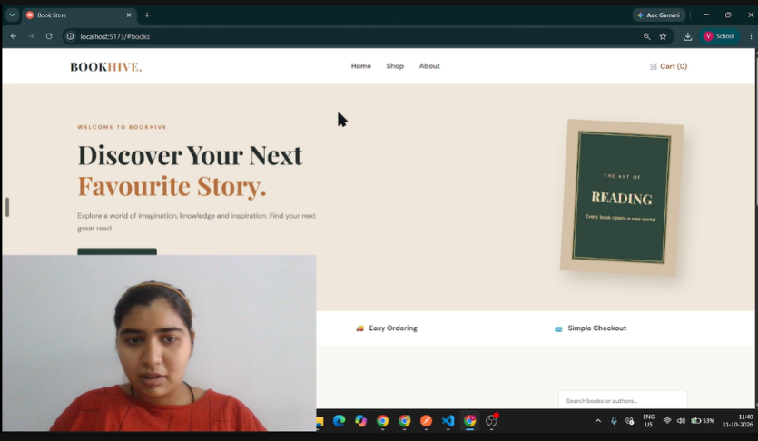

## 🎥 BOOKHIVE – Project Video Demonstration

  

  ▶ Click the thumbnail to watch my complete project explanation on Google Drive.

# 📚 BOOKHIVE – Book Store API Project

## 📖 About the Project

**BOOKHIVE** is a full-stack Book Store application developed using Node.js, Express.js, React.js, and MongoDB.

The project allows users to explore a collection of books, search for books and authors, filter books by category, add books to a shopping cart, and manage their cart.

The backend provides RESTful APIs for book management and order management, while MongoDB is used to store and manage application data.

## 🎥 Project Demonstration

Click the thumbnail below to watch the complete project demonstration, including the frontend, backend, API testing, and database connectivity.

## ✨ Features

### Frontend Features
- Attractive and user-friendly Book Store interface.
- Home page with a welcome banner.
- Display available books from the database.
- Search books by title or author.
- Filter books by category.
- Add books to the shopping cart.
- Remove books from the shopping cart.
- Automatic calculation of the cart total.
- Responsive layout and clean styling.

### Backend Features
- RESTful API development using Express.js.
- Create and retrieve book records.
- Book data management using MongoDB.
- Order management APIs.
- ISBN-based duplicate book validation.
- Middleware for handling JSON requests and cross-origin requests.
- Error handling and API responses.

## 🛠️ Technologies Used

| Technology | Purpose |
|---|---|
| HTML5 | Web page structure |
| CSS3 | Styling and layout |
| JavaScript | Application functionality |
| React.js | Frontend development |
| Vite | Frontend development server |
| Node.js | Backend runtime environment |
| Express.js | Server and REST API development |
| MongoDB | NoSQL database |
| Mongoose | MongoDB object modeling |
| CORS | Cross-origin resource sharing |
| dotenv | Environment variable management |
| Nodemon | Automatic server restarting |
| Postman | API testing |

## 🏗️ Project Structure

``
BOOK-STORE-API-PROJECT/
│
├── backend/
│   │
│   ├── config/
│   │   └── db.js
│   │
│   ├── controllers/
│   │   ├── bookController.js
│   │   └── orderController.js
│   │
│   ├── models/
│   │   ├── Book.js
│   │   └── Order.js
│   │
│   ├── routes/
│   │   ├── bookRoutes.js
│   │   └── orderRoutes.js
│   │
│   ├── .env
│   └── server.js
│
├── frontend/
│   │
│   ├── public/
│   │
│   ├── src/
│   │   ├── assets/
│   │   ├── App.css
│   │   ├── App.jsx
│   │   ├── index.css
│   │   └── main.jsx
│   │
│   ├── index.html
│   ├── package.json
│   └── vite.config.js
│
├── assets/
│   └── bookstore-demo.png
│
├── .gitignore
├── package.json
├── package-lock.json
└── README.md
`

## 👩‍💻 Developed By

**Vibhuti Gadhvi**

Full Stack Development Student

## 📌 Repository

GitHub: https://github.com/vibhutigadhvi36/Node-JS

---

  <b>BOOKHIVE – Every Book Opens a New World! 📚</b>

